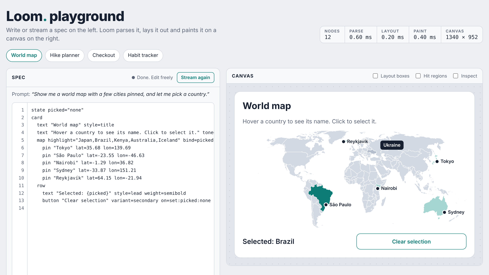

# Loom

**A UI language built for AI models to write, and an engine that renders it entirely on its own.**

Loom has its own parser, layout engine, painter and input handling. It draws straight onto a `<canvas>`, without HTML elements, CSS layout or React. A model streams a few lines of Loom, and the interface appears on screen line by line while the model is still writing.



```
state days=2 hikers=3
card
  text "Yosemite weekend" style=title
  row
    stat label="Days" value={days}
    stat label="Water (L)" value={days * hikers * 3}
  button "Add day" on=inc:days
```

> **Status: 0.1, early foundation.** The engine, 35 components including text input, lists and data, a model connection, tests and debugging tools are in place. Accessibility, scrolling and the docs site come next. See [Limitations](#limitations) before using it for anything real.

---

## Contents

- [Why Loom](#why-loom)
- [Quick start](#quick-start)
- [The Loom language](#the-loom-language)
- [Components](#components)
- [Using the engine](#using-the-engine)
- [Connecting a model](#connecting-a-model)
- [How it works](#how-it-works)
- [Debugging](#debugging)
- [Testing](#testing)
- [Writing a component](#writing-a-component)
- [Theming](#theming)
- [Project structure](#project-structure)
- [Limitations](#limitations)
- [Roadmap](#roadmap)
- [License](#license)

---

## Why Loom

Most generative UI today has a model write React code or JSON, then hands it to a web framework. Loom takes a different approach:

| | Model writes React/JSX | Loom |
|---|---|---|
| Half-finished output | Can't render until the code compiles | Every finished line renders immediately |
| A mistake in the output | One syntax error breaks the component | The bad line is skipped with a clear message |
| Safety | Generated code must be sandboxed | Specs can't run code at all |
| Who controls the look | Whatever CSS the model writes | The engine; the model only picks roles like `variant=secondary` |
| Build step | Compile and bundle | None: text in, pixels out |

Four ideas drive the design:

1. **Line-based and streamable.** One element per line and indentation for nesting, so a partial response is always a valid, smaller screen.
2. **Safe by construction.** `{expressions}` can only read state, do arithmetic and call a few whitelisted functions. There is no route from a spec to JavaScript.
3. **The engine owns the design.** Specs never contain colors, fonts or pixel sizes, so every generated screen stays on-brand.
4. **One source of truth.** Each component is defined once. That definition drives validation, documentation and the guide that teaches a model the language, so none of them can fall out of sync.

---

## Quick start

Requires Node.js 18 or newer.

```bash
git clone https://github.com/premmannava/loom.git
cd loom
npm install
npm run dev        # opens the playground
```

| Command | What it does |
|---|---|
| `npm run dev` | Starts the playground with live reload |
| `npm test` | Runs the unit, contract, streaming, fuzz and interaction tests |
| `npm run test:visual` | Runs the visual regression tests (Playwright) |
| `npm run test:visual:docker` | Same, in the Linux image the baselines come from; add `VISUAL_ARGS=--update-snapshots` to update them |
| `npm run bench` | Benchmarks parse, layout and paint on 1,000- and 5,000-element specs |
| `npm run eval` | Scores a real model on 41 requests ([Measure it](#measure-it)) |
| `npm run guide:size` | Measures the model guide by section, per mode and profile |
| `npm run typecheck` | Type-checks everything |
| `npm run build` | Builds the library into `dist/` |
| `npm run build:playground` | Builds the playground as a static site into `dist-playground/` |
| `npm run docs:components` | Regenerates the component reference in this README |
| `npm run docs:check` | Fails if the component reference is out of date |
| `npm run new:component -- <name>` | Scaffolds a component and its test file, and registers it |
| `npm run build:world` | Regenerates the map's country outlines |

The playground streams sample specs as a model would. Once a sample finishes you can edit the spec, toggle the debugging overlays, and watch state and emitted actions in the panels.

---

## The Loom language

### Elements

One element per line: its type, optional quoted text, then `name=value` props.

```
button "Save changes" variant=secondary on=emit:save
```

Prop values can be bare (`variant=secondary`), quoted (`label="Water (L)"`) or an expression (`value={price * qty}`). Quotes can be escaped with a backslash.

### Nesting

Indent children under a container. Two spaces is the convention; tabs count as two spaces.

```
card
  text "Your order" style=title
  row
    button "Cancel" variant=secondary
    button "Pay"
```

### State

Declare state on unindented `state` lines, usually at the top. Values are numbers, `true`/`false`, `null`, text, lists `[…]` and records `{name: value}`.

```
state qty=2 price=24 gift=false name="Ada"
state todos=[{text: "Pack water", done: false}, {text: "Snacks", done: true}]
```

A value must fit on one line, however long, so a streamed spec can render line by line. Lists and records hold data only: they're parsed, never run, and are limited to 20 levels deep and 10,000 values.

State declared in a spec only sets the starting value. A value the user has already changed is kept when the spec is re-parsed with the same declaration (while streaming, or after an edit elsewhere). When a new spec declares a different starting value, such as a refined screen with new data, the new value replaces the old one. Values your app set itself are never replaced by a declaration. Your app can supply data too, with `loom.state.set("products", rows)` ([Lists](#lists)).

### Expressions

Anything inside `{…}` is evaluated against state.

```
state qty=2 price=24 gift=true
text "Total: ${qty * price + (gift ? 4 : 0)}"
stat label="Each" value={round(price / 3, 2)}
```

- Operators: `+ - * / %`, `== != < <= > >=`, `&& || !`, and `a ? b : c`
- Text joins with `+`: `{'$' + price}` (use single quotes inside a quoted prop)
- Functions: `min`, `max`, `round(n, digits)`, `floor`, `ceil`, `abs`, `fixed(n, digits)`, and the list and formatting functions in [Lists](#lists)
- Fields and items: `{order.city}`, `{cart[0].price}`, `{todos.length}`
- Words inside `{…}` are state names, so quote text: `{done ? 'Packed' : 'To pack'}`
- There is no assignment, no calling methods and no global access, and `__proto__`, `constructor` and `prototype` can't be read. Anything that can't be read shows as `—` rather than guessing, and the parser warns about names nothing defines.

### Actions

Interactive elements run actions from their `on=` prop.

| Action | Effect |
|---|---|
| `inc:key` or `inc:key:by` | Add 1 (or `by`) |
| `dec:key` or `dec:key:by` | Subtract 1 (or `by`), never below 0 |
| `toggle:key` | Flip true/false |
| `set:key:value` | Set a literal, or an expression: `set:total:{a + b}` |
| `emit:name` or `emit:name:value` | Tell the host app what the user chose |
| `go:screen` | Show another screen ([Screens](#screens)) |
| `back` | Return to the previous screen |
| `notify:'message'` | Show a short message for a few seconds; it can include `{expressions}` |
| `add:list:value` | Add an item to the end of a list: `add:todos:{text: 'Map', done: false}` |
| `remove:t` or `remove:list:index` | Remove the current item inside `each`, or the item at a position |
| `clear:list` | Empty a list |

The key of `inc`, `dec`, `toggle` and `set` can be a path into data, like `toggle:t.done` ([Lists](#lists)). A quoted value is text: `set:msg:'Hi there'`.

Run several in order with `;`:

```
state qty=2 placed=false
button "Place order" on="set:placed:true;emit:order:{qty}"
```

`emit` is how a generated screen talks back to your app, for example to send the user's choice to the model for the next step.

`notify` shows a message at the bottom of the visible area, drawn by the engine in the theme's colors, and fires a `notify` event so your app can also announce it. Quote the message when it has spaces or `;`:

```
button "Add to cart" on="inc:items;notify:'Added. {items} in your cart'"
```

### Lists

`each` repeats what's indented under it once per item of a list. It has no look of its own: the copies sit in the container around it, so `each` inside a `row`, `grid`, `list` or `tabs` makes one cell, row or tab per item.

```
state todos=[{text: "Pack water", done: true}, {text: "Charge headlamp", done: false}]
card
  text "{count(todos, 'done')} of {len(todos)} packed" tone=muted
  each items=todos as=t
    row
      check "{t.text}" bind=t.done
      button "Remove" variant=secondary on=remove:t
  button "Add snacks" on="add:todos:{text: 'Snacks', done: false}"
```

| Prop | Meaning |
|---|---|
| `items` | The list: a state name, a field (`o.lines`) or an `{expression}` |
| `as` | Name of the current item inside (default `item`) |
| `index` | Name of its position, from 0 |
| `key` | A value unique to each item, like `{t.id}`, so focus stays with the item when the list changes (default: the position) |

- **Reading:** `{t.text}` inside the `each`. A loop variable only exists inside its `each`; using it outside is a warning.
- **Changing an item:** `bind=t.done`, `toggle:t.done`, `inc:item.qty`. This works only when `items=` names a list in state, not a computed one. Changes never edit data in place: the whole list is replaced, so the `change` event reports it (`todos`) and your app can save it.
- **Changing the list:** `add`, `remove` and `clear` (see [Actions](#actions)).
- **Lists in lists:** put an `each` inside an `each`, as in `each items=o.lines as=line`. Inner items can read outer ones.
- **Limits:** at most 500 items per `each`, and 10,000 repeated elements per screen however lists nest. Past either, the rest are left out with a warning.

List functions, for computing instead of typing numbers:

| Function | Result |
|---|---|
| `len(list)` | Number of items |
| `count(list, 'done')` | Items whose field is true |
| `sum(list)`, `sum(list, 'price')`, `sum(list, 'price', 'qty')` | Total of the items, of a field, or of two fields multiplied per item (cart totals) |
| `avg(list, 'field')` | Average |
| `join(list)`, `join(list, 'name', ' / ')` | Text listing the items or a field |
| `includes(list, value)` | Whether a value is in the list |
| `min(list)`, `max(list)`, `min(list, 'price')`, `max(list, 'price')` | Smallest and largest, of the items or of a field |
| `count(list, 'cat', 'Gas')` | Items whose field equals a value |
| `filter(list, 'done')`, `filter(list, 'cat', 'Gas')` | The items whose field is true, or equals a value, as a list |
| `find(list, 'id', picked)` | The first item whose field equals a value, or `null`: `{find(rooms, 'id', room).rate}` |
| `search(list, 'name', query)` | Items whose field contains some text, ignoring case (all of them for empty text) |
| `sort(list, 'price')`, `sort(list, 'price', 'desc')`, `sort(list)` | The list in order, by a field or by value |
| `take(list, 3)` | The first items |

They combine: `{money(sum(filter(tx, 'cat', 'Gas'), 'amount'))}`, `{take(sort(runners, 'miles', 'desc'), 3)}`. Use them for counts and totals. To hide items people can still change (`bind=t.done`), keep `each items=todos` and put `if=` on the repeated element, because a filtered list is a copy and can't be written to.

Formatting, for text people read:

| Function | Result |
|---|---|
| `money(2400)`, `money(-84.1)`, `money(n, 'EUR')` | `$2,400.00`, `-$84.10`, `€…` |
| `number(37000)`, `number(n, 2)` | `37,000`; always two decimals |
| `plural(n, 'item')`, `plural(n, 'child', 'children')` | `1 item`, `3 items`, `2 children` |
| `lower(text)`, `upper(text)`, `trim(text)` | Text in lower or upper case, or without spaces at the ends |

Numbers and money are formatted in US English for now.

Your app can pass its own data, which is copied into plain, frozen Loom data (functions, class instances and cycles are refused with a clear error):

```ts
loom.state.set("products", await fetchProducts());
loom.on("change", ({ key, value }) => { if (key === "cart") saveCart(value); });
```

### Screens

A spec can hold several screens. Only one shows at a time: the first, until a button moves to another with `go:name`. `back` returns to the previous one, and the visible screen's name is in `{screen}`.

```
state qty=1
screen name=product title="Trail socks"
  stepper "Quantity" bind=qty min=1
  button "Add to cart" on=go:cart
screen name=cart title="Your cart"
  text "{qty} pairs"
  button "Keep shopping" variant=secondary on=back
```

State is shared by every screen. Screens only go at the top level, and their names are plain words (letters, digits and `_`). `go:` to a screen that doesn't exist does nothing. Your app can move between screens too, with `loom.go("cart")` and `loom.back()`, and hears every move through the `navigate` event.

### Conditions

Every element accepts `if=`. The element (and everything inside it) is shown only while the condition is true.

```
state water=true read=false walk=true drink=true
text "Packed!" tone=good if=water
text "All done" if={read && walk && drink}
```

To show several lines under one condition, put them under a line holding only `if=`. Like `each`, it has no look of its own:

```
if={count(todos, 'done') == len(todos)}
  text "All done!" tone=good
  button "Start over" on=clear:todos
```

### Comments

Lines starting with `#` are ignored.

### Errors

Loom never stops on a mistake. Each problem becomes a diagnostic with a line number:

- **Errors** (unknown element, element in the wrong place, nesting more than 100 levels deep): that line and anything nested under it are skipped.
- **Warnings** (unknown prop, bad value, broken expression, a name nothing defines, a loop variable outside its `each`): the element still renders, and the bad part is ignored.

```
L10  Unknown element "sparkle". It was skipped, along with anything inside it
L4   "button" has no prop "colour". Known props: on, variant, disabled, if
L7   variant should be one of primary, secondary, danger; got "huge"
```

---

## Components

<!-- CATEGORIES:START (generated from src/components) -->
| Category | Components |
|---|---|
| Layout | [`column`](#column), [`row`](#row), [`grid`](#grid), [`card`](#card), [`list`](#list), [`list-item`](#list-item), [`accordion`](#accordion), [`divider`](#divider), [`spacer`](#spacer), [`each`](#each) |
| Content | [`text`](#text), [`image`](#image), [`code`](#code), [`badge`](#badge), [`avatar`](#avatar) |
| Data | [`stat`](#stat), [`rating`](#rating), [`map`](#map), [`pin`](#pin) |
| Input | [`button`](#button), [`link`](#link), [`check`](#check), [`switch`](#switch), [`radio`](#radio), [`stepper`](#stepper), [`slider`](#slider), [`input`](#input) |
| Navigation | [`screen`](#screen), [`tabs`](#tabs), [`tab`](#tab), [`breadcrumb`](#breadcrumb), [`pagination`](#pagination) |
| Feedback | [`progress`](#progress), [`skeleton`](#skeleton), [`empty`](#empty) |
<!-- CATEGORIES:END -->

All components also accept `if=` ([Conditions](#conditions)). `map` and `pin` ship in a separate entry point, `loom-ui/map`, because the country outlines add about 76 KB.

<!-- COMPONENTS:START (generated from src/components) -->
### `column`

Stacks its children vertically.

| Prop | Type | Description |
|---|---|---|
| `gap` | number | Space between children in pixels (default 8). |
| `pad` | number | Inner padding in pixels (default 0). |

Children: any elements.

```
column gap=6
  text "First"
  text "Second"
```

### `row`

Places its children side by side, splitting the width equally.

| Prop | Type | Description |
|---|---|---|
| `gap` | number | Space between children in pixels (default 10). |
| `pad` | number | Inner padding in pixels (default 0). |
| `align` | `top` / `center` / `bottom` | Vertical alignment of children: top, center or bottom. |

Children: any elements.

```
row gap=10
  button "Cancel" variant=secondary
  button "Save"
```

### `grid`

Places children in as many equal columns as fit, so the same screen works on a phone and a desktop.

| Prop | Type | Description |
|---|---|---|
| `min` | number | Narrowest a column may be, in pixels (default 200). |
| `gap` | number | Space between children in pixels (default 14). |

Children: any elements.

```
grid min=140 gap=10
  stat label="Orders" value=12
  stat label="Returns" value=1
  stat label="Rating" value=4.8
```

### `card`

A surface that groups related content, stacked vertically. Give it on= to make the whole card pressable.

| Prop | Type | Description |
|---|---|---|
| `gap` | number | Space between children in pixels (default 14). |
| `pad` | number | Inner padding in pixels (default 22). |
| `on` | action | Actions to run when the card is pressed, e.g. emit:changed. Separate several with ; |

Children: any elements.

```
card
  text "Order summary" style=title
  text "2 items" tone=muted
card on=emit:open_order
  text "Trail runner socks" weight=semibold
  text "Arrives Thursday" tone=muted
```

### `list`

A bordered list of rows, separated by lines. Use list-item children.

Children: `list-item`.

```
list
  list-item "Trail runner socks" detail="Merino blend" trailing="$24"
  list-item "Rain shell" detail="Packs into its pocket" trailing="$129" on=emit:open_shell
```

### `list-item`

One row of a list: a title, an optional detail line and an optional value on the right. Give it on= to make it pressable.

| Prop | Type | Description |
|---|---|---|
| `"text"` | text, required | The row's title. |
| `detail` | string | A second, quieter line under the title. |
| `trailing` | string | A short value on the right, like a price or a count. |
| `on` | action | Actions to run when the row is pressed, e.g. emit:changed. Separate several with ; |

Only inside: `list`.

```
list-item "Rain shell" detail="Packs into its pocket" trailing="$129" on=emit:open_shell
```

### `accordion`

A heading that shows or hides the content under it when pressed. Stack several for an FAQ.

| Prop | Type | Description |
|---|---|---|
| `"text"` | text, required | The heading. |
| `bind` | state, required | A true/false state name: true while open. |
| `gap` | number | Space between children in pixels (default 10). |
| `on` | action | Actions to run after it opens or closes, e.g. emit:changed. Separate several with ; |

Children: any elements.

```
state returns=true
accordion "Returns" bind=returns
  text "Free returns within 30 days, unworn."
accordion "Shipping" bind=shipping
  text "Ships in two business days."
```

### `divider`

A thin horizontal line separating sections.

```
divider
```

### `spacer`

Empty vertical space.

| Prop | Type | Description |
|---|---|---|
| `size` | number | Height in pixels (default 8). |

```
spacer size=16
```

### `each`

Repeats what's inside it once per item of a list, in place, with no look of its own. Inside, the current item is called item (or the name given by as=).

| Prop | Type | Description |
|---|---|---|
| `items` | expression, required | The list to repeat over, like todos or {cart}. |
| `as` | name | Name for the current item, used inside: as=t makes {t.text} work. |
| `index` | name | Name for the item's position, counting from 0. |
| `key` | expression | A value unique to each item, like {t.id}, so focus stays with the item when the list changes. Defaults to the position. |

Children: any elements.

```
state gear=[{name: "Tent", kg: 2.1}, {name: "Stove", kg: 0.4}, {name: "Headlamp", kg: 0.1}]
column gap=6
  each items=gear as=g index=i key={g.name}
    text "{i + 1}. {g.name}, {g.kg} kg"
```

### `text`

A paragraph or heading that wraps to the available width. Use {expressions} to show state.

| Prop | Type | Description |
|---|---|---|
| `"text"` | text, required | The words to show. May include {expressions}. |
| `style` | `display` / `title` / `lead` / `body` / `caption` | display, title, lead, body or caption. |
| `weight` | `regular` / `semibold` / `bold` | regular, semibold or bold. Titles default to bold. |
| `tone` | `default` / `muted` / `accent` / `good` / `warn` / `bad` | Color role: default, muted, accent, good, warn or bad. |
| `align` | `left` / `center` / `right` | left, center or right. |
| `strike` | boolean | Draw a line through the text, e.g. for an old price. |

```
state guests=2 nights=3
text "Weekend in Yosemite" style=title
text "{guests} guests, {nights} nights" tone=muted
text "$160" tone=muted strike=true
```

### `image`

A picture, such as a product photo. The quoted text says what it shows, and is displayed if the image can't load.

| Prop | Type | Description |
|---|---|---|
| `"text"` | text, required | What the image shows, e.g. Blue trail runners from the side. |
| `src` | string, required | The image URL. Only the app's own site and hosts it allows will load. |
| `ratio` | `16:9` / `4:3` / `3:2` / `1:1` / `2:3` / `3:4` | Width to height: 16:9, 4:3, 3:2, 1:1, 2:3 or 3:4. The space is kept while the image loads. |
| `fit` | `cover` / `contain` | cover fills the space and crops the edges; contain shows the whole image. |

```
image "Ridgeline trail runners, side view" src="/images/ridgeline.jpg" ratio=4:3
```

### `code`

A short piece of code or a command, in a monospaced font on a tinted block.

| Prop | Type | Description |
|---|---|---|
| `"text"` | text, required | The code. Long lines wrap. |

```
code "npm install loom-ui"
```

### `badge`

A small rounded label for a status or a short tag, like Shipped or New.

| Prop | Type | Description |
|---|---|---|
| `"text"` | text, required | The label, one or two words. |
| `tone` | `accent` / `good` / `warn` / `bad` / `muted` | Color role: accent, good, warn, bad or muted. |

```
badge "Shipped" tone=good
```

### `avatar`

A person's initials in a circle, with their name and an optional detail line beside it.

| Prop | Type | Description |
|---|---|---|
| `"text"` | text, required | The person's name. The initials come from it. |
| `detail` | string | A second line under the name, like a role. |
| `size` | `sm` / `md` / `lg` | sm, md or lg. |
| `tone` | `accent` / `good` / `warn` / `bad` / `muted` | Circle color role: accent, good, warn, bad or muted. |
| `name` | boolean | Show the name beside the circle (default true). |

```
avatar "Ada Lovelace" detail="Trip organizer"
```

### `stat`

A labelled number, for key figures like totals or counts.

| Prop | Type | Description |
|---|---|---|
| `label` | string, required | Short caption above the value. |
| `value` | string, required | The figure to show, usually an {expression}. |
| `tone` | `default` / `muted` / `accent` / `good` / `warn` / `bad` | Color role: default, muted, accent, good, warn or bad. |
| `align` | `left` / `center` | left or center. |

```
state price=24 qty=2
stat label="Total" value="${price*qty}"
```

### `rating`

A star rating. Shows value= as stars, or with bind= lets the user pick a rating.

| Prop | Type | Description |
|---|---|---|
| `value` | number | The rating to show, e.g. 4.5. Ignored when bind= is set. |
| `max` | number | How many stars (default 5). |
| `bind` | state | A number state the user sets by pressing a star. |
| `on` | action | Actions to run after the user picks a rating, e.g. emit:changed. Separate several with ; |

```
state stars=4
rating value=4.5
rating bind=stars
```

### `button`

A pressable button that runs actions. Use emit: to tell the app what the user chose.

| Prop | Type | Description |
|---|---|---|
| `"text"` | text, required | The button label. |
| `on` | action | What happens when pressed, e.g. inc:count, set:done:true, emit:book. Separate several with ; |
| `variant` | `primary` / `secondary` / `danger` | primary (filled), secondary (outlined) or danger. |
| `disabled` | condition | Expression; when true the button is greyed out and can't be pressed. |

```
button "Book now" on=emit:book
button "Back" variant=secondary on=dec:step
```

### `link`

Pressable text for a secondary action, lighter than a button.

| Prop | Type | Description |
|---|---|---|
| `"text"` | text, required | The link text. |
| `on` | action, required | What happens when pressed, e.g. emit:size_guide. |

```
link "Size guide" on=emit:size_guide
```

### `check`

A checkbox that toggles a true/false state value.

| Prop | Type | Description |
|---|---|---|
| `"text"` | text, required | The label next to the box. |
| `bind` | state, required | The state name this checkbox reads and writes. |

```
state agreed=false
check "I agree to the terms" bind=agreed
```

### `switch`

An on/off switch with a label, for settings that take effect right away.

| Prop | Type | Description |
|---|---|---|
| `"text"` | text, required | The label for the setting. |
| `bind` | state, required | The true/false state name this switch reads and writes. |
| `on` | action | Actions to run after it is switched, e.g. emit:changed. Separate several with ; |

```
state updates=true
switch "Email me order updates" bind=updates
```

### `radio`

One choice among several. Give each radio in a group the same bind= and its own value=.

| Prop | Type | Description |
|---|---|---|
| `"text"` | text, required | The label for this choice. |
| `bind` | state, required | The state name the group shares; it holds the chosen value. |
| `value` | string, required | What bind= is set to when this radio is chosen. |
| `on` | action | Actions to run after it is chosen, e.g. emit:changed. Separate several with ; |

```
state size=m
radio "Small" bind=size value=s
radio "Medium" bind=size value=m
radio "Large" bind=size value=l
```

### `stepper`

A number with minus and plus buttons, for small counts like a quantity.

| Prop | Type | Description |
|---|---|---|
| `"text"` | text | An optional label on the left. |
| `bind` | state, required | The number state this stepper reads and writes. |
| `min` | number | Smallest value (default 0). |
| `max` | number | Largest value (no limit if left out). |
| `step` | number | How much each press changes the value (default 1). |
| `on` | action | Actions to run after the value changes, e.g. emit:changed. Separate several with ; |

```
state qty=2
stepper "Quantity" bind=qty min=1 max=10
```

### `slider`

Picks a number in a range by dragging a handle, or with the arrow keys. Good for prices, distances and amounts.

| Prop | Type | Description |
|---|---|---|
| `"text"` | text | An optional label above the slider. Show the value with an {expression}. |
| `bind` | state, required | The number state this slider reads and writes. |
| `min` | number | Smallest value (default 0). |
| `max` | number | Largest value (default 100). |
| `step` | number | The value moves in steps of this size (default 1). |
| `on` | action | Actions to run after the user lets go, or after each arrow key, e.g. emit:changed. Separate several with ; |

```
state maxPrice=120
slider "Up to ${maxPrice}" bind=maxPrice min=20 max=300 step=10
```

### `input`

A text field people type into, such as a name, an email, a search or a new item. Each keystroke writes its bind= state.

| Prop | Type | Description |
|---|---|---|
| `"text"` | text | The label above the field. Leave it out only when the screen makes the purpose obvious. |
| `bind` | state, required | The state name or path it reads and writes, like task or t.title. |
| `placeholder` | string | A hint shown while the field is empty, like e.g. Sunscreen. |
| `kind` | `text` / `email` / `number` / `password` / `search` | text, email, number, password or search. Picks the phone keyboard and autofill; number writes a number, or null while empty. |
| `on` | action | Actions to run when Enter is pressed, after the value is written, e.g. emit:changed. Separate several with ; |
| `disabled` | condition | Expression; when true the field is greyed out and can't be typed in. |
| `max` | number | Longest value in characters (at most 10000). |

```
state task="" todos=[]
input "New item" bind=task placeholder="e.g. Sunscreen" on="add:todos:{task};set:task:''"
text "{plural(len(todos), 'item')}" tone=muted
```

### `screen`

One screen of a multi-screen interface. Only one screen shows at a time: the first, until a button runs go:name or back.

| Prop | Type | Description |
|---|---|---|
| `name` | name, required | The screen's name, used by go:name. The visible screen's name is in {screen}. |
| `title` | string | A heading shown at the top of the screen. |
| `gap` | number | Space between children in pixels (default 14). |

Children: any elements.

Only inside: `root`.

```
screen name=cart title="Your cart"
  text "2 items"
  button "Checkout" on=go:checkout
screen name=checkout title="Checkout"
  text "Pay with card"
  button "Back to cart" variant=secondary on=back
```

### `tabs`

A row of tabs that switches between sections. Only the selected tab's content is shown.

| Prop | Type | Description |
|---|---|---|
| `bind` | state, required | The state name holding the selected tab's value. |
| `on` | action | Actions to run after the user switches tabs, e.g. emit:changed. Separate several with ; |

Children: `tab`.

```
state view=overview
tabs bind=view
  tab "Overview" value=overview
    text "Light, quick-drying trail runners."
  tab "Specs" value=specs
    text "280 g, 6 mm drop."
```

### `tab`

One tab inside tabs: its label, and the content shown while it is selected.

| Prop | Type | Description |
|---|---|---|
| `"text"` | text, required | The tab's label. |
| `value` | string | What the tabs' bind= holds while this tab is selected (default: the label). |
| `gap` | number | Space between children in pixels (default 12). |

Children: any elements.

Only inside: `tabs`.

```
tab "Reviews" value=reviews
  text "4.8 out of 5 from 212 hikers."
```

### `breadcrumb`

Where the user is, as a path like Shop / Shoes / Trail runners. Earlier steps can be pressed to go back.

| Prop | Type | Description |
|---|---|---|
| `"text"` | text, required | The steps, separated by slashes. The last one is the current page. |
| `bind` | state | State that receives the pressed step's text. |
| `on` | action | Actions to run after a step is pressed, e.g. emit:changed. Separate several with ; |

```
state at="Trail runners"
breadcrumb "Shop / Shoes / Trail runners" bind=at
```

### `pagination`

Previous, next and page-number buttons for moving through pages of results.

| Prop | Type | Description |
|---|---|---|
| `bind` | state, required | The number state holding the current page, starting at 1. |
| `pages` | number, required | How many pages there are. |
| `on` | action | Actions to run after the page changes, e.g. emit:changed. Separate several with ; |

```
state page=3
pagination bind=page pages=12
```

### `progress`

A horizontal bar showing how far a value is toward a maximum.

| Prop | Type | Description |
|---|---|---|
| `value` | number, required | Current amount, usually an {expression}. |
| `max` | number | The full amount (default 100). |
| `label` | string | Optional caption above the bar. |
| `tone` | `default` / `muted` / `accent` / `good` / `warn` / `bad` | Color role: default, muted, accent, good, warn or bad. |

```
state done=3
progress value={done} max=5 label="{done} of 5 steps"
```

### `skeleton`

A grey placeholder shown while content loads: lines of text, a block or a circle.

| Prop | Type | Description |
|---|---|---|
| `shape` | `text` / `block` / `circle` | text (lines), block or circle. |
| `lines` | number | How many lines, for shape=text (default 3). |
| `height` | number | Height of a block, or diameter of a circle (default 120 and 48). |

```
skeleton lines=2
skeleton shape=block height=80
```

### `empty`

A friendly message for when there is nothing to show, with an optional button to move on.

| Prop | Type | Description |
|---|---|---|
| `"text"` | text, required | The message, e.g. No orders yet. |
| `detail` | string | A line explaining what to do next. |
| `action` | string | Label for a button under the message. |
| `on` | action | Actions to run when the button is pressed, e.g. emit:changed. Separate several with ; |

```
empty "No results" detail="Try a wider price range." action="Clear filters" on=emit:clear_filters
```

### `map`

A world map with clickable countries. Highlight countries by name and add pin children for places.

| Prop | Type | Description |
|---|---|---|
| `highlight` | string | Comma-separated country names to tint, e.g. "Japan,Brazil". |
| `bind` | state | State name that receives the clicked country's name. |

Children: `pin`.

```
state picked=none
map highlight="Japan,Kenya" bind=picked
  pin "Tokyo" lat=35.68 lon=139.69
```

### `pin`

A labelled point on a map, placed by latitude and longitude.

| Prop | Type | Description |
|---|---|---|
| `"text"` | text, required | The place name shown next to the pin. |
| `lat` | number, required | Latitude in degrees (-90 to 90). |
| `lon` | number, required | Longitude in degrees (-180 to 180). |

Only inside: `map`.

```
pin "Nairobi" lat=-1.29 lon=36.82
```
<!-- COMPONENTS:END -->

---

## Using the engine

> Loom isn't published to npm yet. Until it is, build it with `npm run build` and import from `dist/`, or import from `src/` in your own bundler. The examples use the package name it will have, `loom-ui`.

```ts
import { Loom, coreComponents } from "loom-ui";
import { mapComponents } from "loom-ui/map";

const canvas = document.querySelector("canvas")!;
const loom = new Loom(canvas, {
  components: [...coreComponents, ...mapComponents],
});

loom.setSpec(`
state count=0
card
  text "Clicked {count} times"
  button "Click me" on=inc:count
`);
```

The canvas fills its parent's width and grows to fit its content.

### Options

| Option | Default | Description |
|---|---|---|
| `components` | required | The components this instance understands |
| `theme` | `"auto"` | A `Theme`, or `"auto"` to follow light/dark mode and `--loom-*` CSS variables |
| `width` | parent width | A fixed width in CSS pixels |
| `minHeight` | `0` | Minimum canvas height |
| `padding` | `20` | Space around the whole screen |
| `animate` | `true` | Fade new elements in (off when the user prefers reduced motion) |
| `imageHosts` | `[]` | Hosts images may load from besides your own site ([Images](#images)) |
| `loadImage` | an `` with CORS | Custom image loading, for tests, server rendering or signed URLs |
| `onWarning` | `console.warn` | Receives problems found while running, like a blocked image |
| `editor` | an `<input>` over the field | How text fields are typed into ([Typing](#typing)); `loom-ui/testing` passes a fake one |

### Methods

| Method | Description |
|---|---|
| `setSpec(text, { resetState? })` | Replace the whole spec |
| `beginStream({ keepState? })` | Start a streamed spec; clears state unless `keepState` |
| `push(chunk)` | Append streamed text. Only complete lines render |
| `endStream()` | Finish the stream and render the last line |
| `on(event, handler)` | Subscribe to an event; returns an unsubscribe function |
| `state.get(key)` / `state.set(key, value)` | Read or change state from your app |
| `go(screen)` / `back()` | Show another screen, or the previous one |
| `screens` / `currentScreen` / `canGoBack` | The spec's screen names, the visible one, and whether `back()` can move |
| `notify(text)` | Show a short message, as `notify:` does |
| `imagesLoaded()` | A promise that resolves once every requested image has loaded or failed |
| `setTheme(theme)` | Switch themes |
| `find(type)` | All nodes of a type, e.g. `loom.find("button")` |
| `expose(name?)` | Put the instance on `window` for the console (default `window.loom`) |
| `destroy()` | Remove listeners and stop rendering |

### Events

| Event | Payload | When |
|---|---|---|
| `action` | `{ name, value, node }` | An `emit:` action ran |
| `change` | `{ key, value }` | A state value changed |
| `diagnostics` | `Diagnostic[]` | The spec's problems changed |
| `render` | `Metrics` | A frame was painted (node count and timings) |
| `inspect` | `{ node, box }` or `null` | Inspect mode selected something |
| `navigate` | `{ screen, from }` | The visible screen changed |
| `notify` | `{ text }` | A message was shown |

```ts
loom.on("action", ({ name, value }) => {
  if (name === "order") submitOrder(value);
});
```

### Images

A spec can name any image URL, and a model writes specs, so Loom only loads images from your own site (the page's origin) and from hosts you list. Anything else, including `data:` and `javascript:` URLs, is blocked: the `image` shows its description instead, and the console says which host to allow.

```ts
const loom = new Loom(canvas, {
  components: coreComponents,
  imageHosts: ["cdn.example.com", "*.images.example.com"], // * allows subdomains; https only
});
```

Images load with CORS (`crossOrigin="anonymous"`), so their server must send `Access-Control-Allow-Origin` (most image CDNs do). The playground allows `images.unsplash.com`, and its "Trail gear" and "Gear finder" samples use real photos from there. The space for each image is kept from its `ratio=` while it loads, so the screen doesn't jump.

### Keyboard

The canvas is focusable. Tab and Shift+Tab move between interactive elements, Enter or Space presses the focused one, and a focus ring is drawn on the canvas. A focused `slider` also moves with the arrow keys, Page Up and Page Down, Home and End.

On touch screens, vertical swipes still scroll the page and pinches still zoom, while horizontal drags go to the canvas, so sliders can be dragged.

### Typing

An `input` field is drawn on the canvas like everything else. While someone types in one, Loom places a real `<input>` exactly over it, with the field's font and colors and a transparent background, so the browser handles typing, selection, copy and paste, undo, input methods for Chinese, Japanese and Korean, autocorrect, password managers, autofill and the phone keyboard. It's removed when they leave the field.

- Clicking or tapping a field, or reaching it with Tab, starts typing there. Tabbing onto the canvas starts typing in its first element if that's a field.
- Every keystroke writes the field's `bind=`, so filters, counts and greetings update as people type. While an input method is composing, the value is written when the text is finished.
- Enter runs the field's `on=`. Tab and Shift+Tab move to the next or previous element, typing in it if it's a field. Escape stops typing.
- `kind=` picks the input type: `email` and `password` get the right autofill, `number` a number keyboard and a number (or `null`) in state, `search` a search field.
- The `<input>` sits right after the canvas in the page, so Tab from the last element leaves the canvas as it would from any field. It follows the field through scrolling, resizing and layout changes.

A password's value is still state: it reaches your app through `change` events like any form value.

---

## Connecting a model

### Try it in the playground

The playground's **Ask a model** box sends your request to a real model and streams the screen in as the model writes it. It works with any server that speaks the OpenAI chat format: LM Studio, Ollama, vLLM and llama.cpp on your own machine, or DeepSeek, OpenAI, OpenRouter and others in the cloud.

1. Start a model server. With **LM Studio**: load a model (Qwen3 14B works well), open the Developer tab and start the server. It listens on `http://localhost:1234/v1`, which is the default, so no settings are needed.
2. For anything else, copy `.env.example` to `.env.local` and fill it in. `.env.local` is never committed.
3. Run `npm run dev`, pick the model in the box, describe a screen and press **Ask**.

```bash
# .env.local
LOOM_MODEL_URL=http://localhost:1234/v1   # LM Studio (default); Ollama: http://localhost:11434/v1
LOOM_MODEL=                               # optional: the model to preselect
LOOM_API_KEY=                             # only for servers that need one
LOOM_USER_SUFFIX=                         # optional: added to every request, e.g. /no_think for Qwen3
```

The dev server passes the playground's requests through to the model server, so the browser needs no CORS settings and never sees the key. While it runs you'll see the model wait, think, write, and fix problems. When it's done, the status line says how long it took, how long until the first line appeared, and whether Loom's parser found problems that a second request fixed. Tick **Refine this screen** to ask for changes to the current screen instead of a new one. It sends the first request, the changes since and the screen as it is now, including your own edits (see [Changing a screen](#changing-a-screen)).

Reasoning models such as Qwen3 and DeepSeek R1 think before writing. Their thinking is hidden from the screen, but it delays the first line. With Qwen3, `LOOM_USER_SUFFIX=/no_think` skips it.

**Copy guide**, under the model guide at the bottom of the playground, copies the same instructions the model gets, for trying Loom in any chat app.

### Measure it

```bash
npm run eval                        # all 41 requests, with the model from .env.local
npm run eval -- --model qwen3-14b   # another model on the same server
npm run eval -- --only data,hard    # some categories or request ids
npm run eval -- --no-repair         # first tries only
```

`eval/cases.ts` holds 41 requests: forms (a login and a sign-up among them), comparisons, dashboards, shopping, multi-screen flows, content, lists of data (a to-do list, a cart, a kanban board, orders with their lines, a search that filters as you type), harder multi-part requests, and traps like "a big red button" (Loom has no colors).

Some requests also have **behavior checks** (`eval/checks.ts`): the final spec is rendered with the real engine and used. Ticking a box must change the "X of Y done" count, changing a quantity must change the total, Remove must remove an item, typing in a search must filter the list. A spec can be valid and still not work, and these catch that.

The report shows how many specs were valid on the first try and after one repair, whether they used the expected elements, how many worked when used, any invented props or elements, input and output tokens, and time to the first line. It's written to `eval/results/<date>-<model>/` with every generated spec, which you can paste into the playground, and everything the model sent for each request (`<id>.raw.txt`), thinking included.

Token counts are the server's own when it reports them, and "unknown" when it doesn't; they're never filled in with zero. Estimates (characters divided by 4) are labelled as estimates. Reasoning tokens a server reports are part of its output tokens and aren't added again. The time to the first Loom line is when something could be shown, not when the screen is usable.

To compare ways of prompting, give variants. Each request runs once per variant, one after another, with the same model and settings:

```bash
npm run eval -- --guide full,compact                      # the full guide against the compact one
npm run eval -- --guide full,compact --profile shop       # both, describing only the shop profile's elements
npm run eval -- --guide compact --repair-guide same,full  # does repairing with the full guide help?
npm run eval -- --enforce-profile                         # elements outside the profile count as problems
npm run eval -- --stream-usage                            # ask the server for token usage (if it supports it)
npm run guide:size                                        # guide size by section, and what refinement sends
```

The report starts with a side-by-side table on the requests every variant can build. A request that needs an element a profile doesn't have (by its expected elements) isn't sent for that profile; it's listed as not supported. `results.json` records each result's guide mode, profile, repair guide and context policy.

### In your own app

`loom-ui/model` does what the playground does: it streams a spec from an OpenAI-compatible endpoint, removes thinking and code fences, checks the result with Loom's parser, and asks once for a fix.

```ts
import { generateSpec } from "loom-ui/model";

loom.beginStream();
const result = await generateSpec({
  config: { url: "/api/model", model: "qwen3-14b" }, // a route on your server that adds the key
  registry: loom.registry,
  request: "A booking form for a cabin, 2 to 6 guests",
  guide: {
    imageHosts: ["cdn.example.com"],
    actions: [{ name: "book", value: "the number of guests", description: "when the user books" }],
    notes: "A cabin rental site. Prices are per night.",
  },
  onText: (text) => loom.push(text),
  onReset: () => loom.beginStream(), // a fix is coming: start the screen over
});
loom.endStream();
// result.spec, result.diagnostics, result.first, result.repair, result.timings, result.usage, result.messages
```

If your app supplies data with `loom.state.set`, pass its names as `stateNames: ["products"]`, so a spec that reads them isn't flagged as using unknown names and sent back for a needless repair. When a model writes its whole spec inside a thinking block it never closes, `generateSpec` finds the spec there (`result.first.recovered`).

The guide comes from `languageGuide(registry, options)`, generated from the registered components, so it always matches what the engine supports. Its options tell the model which image hosts work, which `emit:` actions your app listens for, and anything about your app it should know.

#### A smaller guide: compact mode and profiles

The full guide is the default. Two options make it smaller:

```ts
guide: {
  mode: "compact",   // "full" (default) or "compact"
  profile: "shop",   // which elements the model is told about: "forms", "lists", "shop", "dashboard", or a list of names
}
```

- **Compact mode** describes each element in one line, generated from the same component definitions: its props with their types and allowed values (`!` marks a required prop), what it holds or where it must go, and what it's for. It keeps the rules that change what a spec does (one line per element, indentation, quoting, local actions versus `emit` events, that a computed list can't be written to, roles instead of colors, image hosts), and shows one worked example instead of four plus one per element. The app's own context (image hosts, actions, notes) comes last, so the part that's the same for every app stays a shared prefix.
- **Profiles** choose the elements the model is told about. A profile's elements bring what they need (`tab` brings `tabs`, `list` brings `list-item`), and `column` and `text` are always included. Examples and instructions that would use an element outside the profile are left out. A profile is chosen by your app; Loom doesn't guess one from the request.

| Guide (with one image host) | Characters | Tokens (estimated) |
|---|---|---|
| full (default) | 23,865 | ~5,970 |
| full, `examples: false` | 19,873 | ~4,970 |
| full, profile `shop` | 17,853 | ~4,460 |
| compact | 8,303 | ~2,080 |
| compact, profile `shop` | 6,570 | ~1,640 |
| compact, profile `forms` | 4,391 | ~1,100 |

Tokens here are characters divided by 4, a rough estimate; `npm run guide:size` prints the current numbers by section. A smaller guide is cheaper and faster to read, but whether a model writes screens as good with it is a question for `npm run eval -- --guide full,compact` on your model. The full guide stays the default until that's been shown.

Three sets of elements are involved, and they're separate:

- **The renderer's**: the registry your Loom was made with. It can show any of them, whoever wrote the spec.
- **The model's**: the profile. The guide only describes these.
- **What's checked**: by default, a spec is checked against the renderer's elements. With `enforceProfile: true`, it's checked against the profile, so an element outside it is sent back for repair.

Examples are chosen explicitly: `examples` turns each element's own short example on or off (default on in full mode, off in compact), and `workedExamples` picks the larger ones by name (`["todo", "cart"]`, or `false` for none). With a profile, an example that uses an element outside it is never shown.

#### Repairs

`generateSpec` asks once for a fix when the parser finds problems (`repairOn: "any" | "errors" | "never"`). With a compact guide, `repairGuide: "full"` sends the full guide for that one repair, still limited to the profile. Each attempt reports the guide it used (`result.first.guide`, `result.repair?.guide`); `npm run eval -- --guide compact --repair-guide same,full` measures whether it helps.

#### Changing a screen

To change the current screen ("make the total bigger"), pass a `refine` context instead of the whole conversation:

```ts
import { generateSpec, nextRefineContext, type RefineContext } from "loom-ui/model";

let context: RefineContext = { task: "A packing list for a 3-day hike", requirements: ["Prices in euros"], spec: first.spec };

const r = await generateSpec({ config, registry, request: "Add a progress bar", refine: { ...context, spec: loom.spec } });
context = nextRefineContext(context, "Add a progress bar", r.spec);
```

It sends the original task, the `requirements` that must always hold, the changes asked for since, the current spec as it is now (hand edits included), and the new change. It doesn't send earlier specs, failed tries or repair messages, so a change costs about the same on the tenth turn as on the second (`npm run guide:size` shows the difference). Its limits:

- Earlier changes are kept as text, up to `contextPolicy.maxChanges` (default 20). Past that the oldest are left out with a note; the current spec still has their effect. `requirements` are never left out, so anything that must survive belongs there.
- App state is sent only if you pass it, as `refine.state`, and only the values you pass.
- Nothing is summarized by another model call.

`result.messages` is the conversation that produced the accepted spec: the guide, the context, the request and the final spec. A rejected repair isn't in it, and a kept repair replaces the first spec. (Before, it included the repair exchange.) `result.transcript` has everything that was sent and received. Passing `result.messages` as `history` still works for apps that want the whole conversation.

#### Usage and timing

`result.usage` adds up the server's token counts over the first try and the repair: `promptTokens`, `completionTokens`, and `reasoningTokens` (part of the completion tokens, not added again). A total is `undefined`, meaning unknown, when any attempt didn't report it; `usage.reported` says how many did. Each attempt also has `inputChars` and `estimatedInputTokens` (characters / 4), `estimatedThinkingTokens`, the guide it used and how long it took. Many servers only report usage while streaming when asked; set `config.streamUsage: true` for those that support `stream_options` (OpenAI, vLLM, recent LM Studio and llama.cpp).

Putting the guide first and the request last means requests with the same guide options share a prefix, which servers with prefix caching (vLLM, llama.cpp, many hosted APIs) can reuse. That's the server's doing: Loom builds the same text each time, but doesn't cache anything itself.

Send the user's choices back to the model with `emit` actions, passing `result.messages` as `history` to continue the conversation:

```ts
loom.on("action", ({ name, value }) => {
  continueConversation(`The user chose ${name}: ${value}`);
});
```

> **Keep API keys on a server.** Point `config.url` at a route on your backend that adds the key, as the playground's dev server does. Never put a model API key in front-end code.

---

## How it works

```
spec text → parse → tree → layout → boxes → paint → canvas pixels
                               ↑                       │
             state ←── actions ←── pointer / keyboard ─┘
```

1. **Parse** (`src/parser.ts`). Each line becomes a node, and indentation decides its parent. Props are checked against the component definitions, and problems become diagnostics. While streaming, the unfinished last line is ignored.
2. **Layout** (`src/layout.ts`). Each component sets its own height given a position and width. Containers place their children: `column` and `card` stack them, `row` splits the width equally and centers them. The result is a box (`x, y, width, height`) for every element. Layout only needs a text measurer, so it runs without a canvas and is unit-tested.
3. **Paint** (`src/engine.ts`). The boxes are walked in order and each component draws itself with canvas calls, using colors from the theme. Interactive components register their boxes as hit regions while painting.
4. **Input**. A click or key press is matched against the hit regions, the component's actions run, state changes, and the pipeline runs again.

Each stage only reruns when its inputs change: editing the spec re-parses, a state change re-lays out, and hovering only repaints. A typical screen renders in well under a millisecond.

---

## Debugging

Browser DevTools can't see inside a canvas, so Loom ships its own tools. All of them are available in the playground and from code.

| Tool | How to use it | What it shows |
|---|---|---|
| Layout boxes | `loom.inspector.setBoxes(true)` | Every box, with its type and size |
| Hit regions | `loom.inspector.setHits(true)` | Exactly what is clickable |
| Inspect mode | `loom.inspector.setInspecting(true)` | Hover to highlight, click to select. The playground jumps to the spec line, and putting the cursor on a spec line selects its element |
| Describe | `loom.inspector.describe(node)` | A node's type, line, props and box |
| Frame capture | `await loom.inspector.captureFrame()` | Every canvas call made in one frame |
| Console | `loom.expose()` | `loom.tree`, `loom.boxes`, `loom.state.snapshot()`, `loom.find("button")` |

To find a bug, first decide which stage it's in:

- **An element is missing or wrong:** check `loom.diagnostics` and `loom.tree` (parse).
- **Wrong position or size:** turn on layout boxes (layout).
- **The box is right but it looks wrong:** capture a frame (paint).
- **A click does nothing:** turn on hit regions (input).

---

## Testing

`loom-ui/testing` runs the real engine (parsing, layout, painting, hit testing, pointer and keyboard handling) in Node against a stand-in canvas that records what is drawn. It works with any test runner.

```ts
import { render } from "loom-ui/testing";

const ui = render(`state n=0
button "Add" on=inc:n
text "Clicked {n} times"`);

ui.press({ type: "button", text: "Add" });
expect(ui.state.n).toBe(1);
expect(ui.text()).toContain("Clicked 1 times");
```

| Helper | What it does |
|---|---|
| `find`, `findAll`, `isShown` | Look elements up by `type`, `text` (as written or as shown) and `line` |
| `press`, `drag`, `click`, `key`, `tab` | Interact through the same pointer and keyboard path as a real user |
| `type(query, text, { replace? })`, `editor` | Type into a field one character at a time, as a person would; `editor` is the text box over the field being typed in. While typing, `key` goes to the field (Enter, Tab, Escape) |
| `set`, `setSpec`, `stream` | Change state, replace the spec, or stream one in chunks |
| `state`, `emitted`, `focused`, `diagnostics`, `warnings` | Read the results |
| `text`, `drawOps`, `hits` | What the last frame drew, and what is clickable |

Map clicks need a real canvas to tell countries apart, so they're covered by the visual tests rather than in Node.

In this repository, the test suites are:

| Suite | Where | What it checks |
|---|---|---|
| Unit | `test/*.test.ts` | Parser, expressions, actions, layout, the model guide |
| Contract | `test/contract.test.ts` | Every registered component against the project rules: docs, layout bounds at three widths, theme-only colors and fonts, hit regions and keyboard reach |
| Streaming | `test/streaming.test.ts` | Every prefix of every sample renders a valid, smaller screen, however the stream is chunked |
| Fuzz | `test/fuzz.test.ts` | Random and damaged specs, expressions and actions never make anything throw (`FUZZ_RUNS=5000 npm test` for a longer run) |
| Visual | `visual/` | Component examples and samples in light and dark at 375 and 1024 px, against baselines in `visual/__screenshots__` |
| Benchmarks | `bench/` | Timings per commit; pull requests are compared with their base |

CI (`.github/workflows/ci.yml`) runs all of them. Visual baselines are made on Linux in the Playwright image, because fonts render differently on each platform: update them with `VISUAL_ARGS=--update-snapshots npm run test:visual:docker`, or let CI do it: add the `update-visual-baselines` label to a pull request (or run the CI workflow by hand with **update-baselines**), and it commits the regenerated images to the branch for review.

---

## Writing a component

A component is one `ComponentDef` object. Registering it is all it takes: the parser validates its props, the model guide describes it, and the engine lays it out and paints it.

In this repository, `npm run new:component -- ribbon` creates the file and its test from a template and registers it. The contract tests then fail until every placeholder is filled in, so `npm test` tells you what's left.

```ts
import type { ComponentDef } from "loom-ui";

export const ribbon: ComponentDef = {
  type: "ribbon",
  category: "content",
  description: "A full-width colored strip with a short notice.",
  text: { description: "The notice.", required: true },
  props: {
    tone: {
      type: "enum",
      values: ["accent", "good", "warn", "bad"],
      default: "accent",
      description: "Color role.",
    },
  },
  example: `ribbon "Free shipping this week" tone=good`,

  layout(box) {
    box.h = 32;
  },

  paint(box, ctx) {
    const p = ctx.props(box.node);
    const color = ctx.theme.colors[p.oneOf("tone", ["accent", "good", "warn", "bad"] as const, "accent")];
    const { g } = ctx;
    ctx.roundRect(box.x, box.y, box.w, box.h, ctx.theme.radius.sm);
    g.fillStyle = color;
    g.fill();
    g.font = ctx.font(600, 13);
    g.fillStyle = ctx.theme.colors.onAccent;
    g.textAlign = "center";
    g.textBaseline = "middle";
    g.fillText(p.text(), box.x + box.w / 2, box.y + box.h / 2 + 1, box.w - 16);
  },
};

const loom = new Loom(canvas, { components: [...coreComponents, ribbon] });
```

What a `ComponentDef` can define:

| Field | Purpose |
|---|---|
| `type`, `category`, `description`, `example` | Identity and documentation; also used in the model guide |
| `text` | Whether it takes quoted text |
| `props` | Prop names, types and descriptions, used for validation and docs |
| `children` | `"any"` or a list of allowed child types; omit for leaf components |
| `parents` | Restrict where it can appear |
| `layout(box, ctx)` | Required. Set `box.h`; containers also lay out `box.children` |
| `paint(box, ctx)` / `paintOver(box, ctx)` | Draw before or after children |
| `hitTest(box, x, y)` | Refine clicks inside the box (the map uses this per country) |
| `drag(ctx)` | Follow the pointer while it's held down (`start`, `move`, `end`); the slider uses this |
| `key(ctx, key)` | Handle a key while focused; return true if handled |
| `visible(node, scope)` | Hide the element beyond `if=` (only the active `screen` shows) |
| `press(ctx)` | What happens on activation; by default it runs the `on` prop |
| `cursor(target)` | Mouse cursor over it |

Use `ctx.props(node)` to read props. It evaluates `{expressions}` and fills templates for you: `num`, `str`, `bool`, `cond`, `oneOf` and `text`.

---

## Theming

Components never use literal colors or sizes. They read design tokens from the theme: `colors`, `space`, `radius`, `font`, `text` sizes and `control` height. Loom ships `lightTheme` and `darkTheme`, and with `theme: "auto"` it follows the page's light or dark mode.

With `theme: "auto"`, you can override colors from CSS with `--loom-*` variables on the canvas or any ancestor:

```css
canvas {
  --loom-accent: #6D28D9;
  --loom-on-accent: #FFFFFF;
}
```

Or build a theme in code:

```ts
import { extendTheme, lightTheme } from "loom-ui";

const brand = extendTheme(lightTheme, {
  colors: { accent: "#6D28D9" },
  radius: { md: 6 },
});
loom.setTheme(brand);
```

---

## Project structure

```
src/
  engine.ts         The Loom class: pipeline, canvas, pointer and keyboard input
  parser.ts         Spec text → node tree, with diagnostics
  expr.ts           The safe expression language
  actions.ts        on= actions
  layout.ts         Headless layout
  component.ts      The ComponentDef contract and PropReader
  registry.ts       The set of components an instance knows
  inspector.ts      Debugging overlays, inspect mode, frame capture
  prompt.ts         Generates the model guide (full and compact)
  profiles.ts       Component profiles: which elements the model is told about
  theme.ts          Design tokens
  text.ts           Text measuring and wrapping
  state.ts          The state store
  components/       Built-in components; map/ is a separate entry point
  testing/          loom-ui/testing: render() and the recording canvas
  model/            loom-ui/model: stream, clean, check and repair a model's spec; refinement context
playground/         The development playground
test/               Unit, contract, streaming, fuzz and interaction tests (Vitest)
visual/             Visual regression page, cases and baselines (Playwright)
bench/              Benchmarks
eval/               The evaluation set and its scoring (npm run eval)
scripts/            Map outlines, component docs, component scaffold, benchmark comparison
.github/workflows/  CI
docs/               Plan, examples and images
CLAUDE.md           Brief for AI assistants working on this repo
docs/images/        README images
```

---

## Limitations

Loom draws everything itself, so it gives up what the browser normally provides for free. Today it does **not** have:

- **Multi-line text, and form validation** (required fields, email format). A model can show a hint with `if=` for now.
- **Screen reader support.** A canvas is invisible to assistive technology. A hidden accessibility layer that mirrors the canvas is planned.
- **Text selection, copy and browser find.**
- **Scrolling regions, overlays, dialogs or menus.**
- **Right-to-left or complex-script text shaping** beyond what the canvas does on its own.

Don't use Loom where accessibility is required until the accessibility layer lands.

---

## Roadmap

The full phase-by-phase plan, including the component pipeline, testing strategy and how a model generates UI on the fly, is in [`docs/PLAN.md`](docs/PLAN.md). [`docs/examples/ecommerce.md`](docs/examples/ecommerce.md) shows the complete store the plan builds toward.

1. **Foundation** (0.1, done): engine, parser, expressions, actions, keyboard focus, inspector, first components, tests, playground.
2. **Components and data**: done so far: grid, list, accordion, badge, avatar, code, rating, link, switch, radio, stepper, tabs, breadcrumb, pagination, skeleton, empty, pressable cards and struck-through text, plus images, a slider (with dragging), screens with `go:` and `back`, `notify:` messages, lists and records with `each`, `if` blocks, list functions and formatting, and text input (a real input placed over the field while typing). Next: scrolling, select, table, chart and dialog, plus the accessibility layer.
3. **Docs site**, built with Loom so every example is live.
4. **Model connection**: started. The playground's Ask a model box, `loom-ui/model` (streaming, cleanup and one repair) and `npm run eval` work with any OpenAI-compatible server. Still to do: a production server package, and comparing the results with other generative UI formats.
5. **An app** built on top.

---

## License

[MIT](LICENSE).

Country outlines in `src/components/map/world.json` come from [Natural Earth](https://www.naturalearthdata.com/) (public domain) via [world-atlas](https://github.com/topojson/world-atlas).
